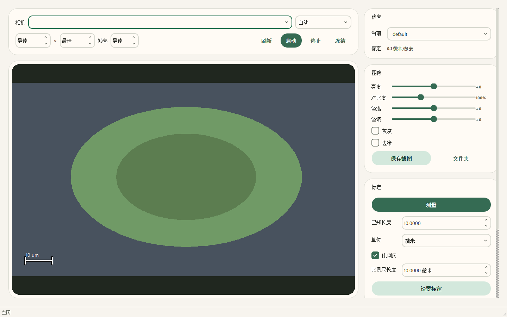

# Open Vision Measure

[](LICENSE)
[](pyproject.toml)

Open Vision Measure is a local-first microscope imaging and measurement
workbench for plant tissue sections. It is an independent, clean-room
implementation inspired by the workflow of camera measurement software; it does
not contain code, assets, or models from JCameraPro.

## 中文简介

Open Vision Measure 是一个本地优先的显微镜图像观察、标定、测量和截图工具，
面向植物组织切片等科研场景。界面支持中文、浅色/深色主题、多物镜倍率独立标定、
微米等物理单位。项目采用 Apache-2.0 许可证，不包含 JCameraPro 的代码、资源或
模型。当前版本不提供自动背景去除或 AI 主体分割。



## Core MVP

- Camera discovery through MSMF, DirectShow, or V4L2 with automatic fallback.
- Automatic highest-resolution, best-format camera mode by default.
- Bounded, non-blocking camera acquisition.
- Live preview, freeze/resume, stop, and screenshot export.
- Brightness, contrast, temperature, tint, grayscale, and edge preview.
- Two-click line measurement in image coordinates.
- Per-magnification physical calibration from a two-click reference.
- Optional draggable fixed-length scale bar in live and saved images.
- Persistent screenshot folder with automatic `capture_0001` sequencing.
- Project save/load and CSV measurement export.
- Unicode Windows paths for screenshots and project files.

Recording, area/perimeter tools, AI background removal, Excel reports,
licensing, payment, updates, and telemetry remain deferred.

## Install and run

Python 3.12 and `uv` are required.

```powershell
uv sync --extra dev
uv run vision-measure
```

On a Windows machine with a camera that is exposed through DirectShow, choose
`刷新`, select the camera, and click `启动`. The combined camera label shows
the backend that was detected.

## Test

```powershell
uv run ruff check .
uv run mypy src
$env:QT_QPA_PLATFORM = "offscreen"
uv run pytest
```

Synthetic-camera tests establish deterministic workflows. They do not prove
compatibility with a specific physical camera or driver.

## Build Windows executable

```powershell
pwsh -NoProfile -File scripts/build_windows.ps1 -Version 0.3.0
```

The command builds `OpenVisionMeasure.exe`, runs its packaged smoke test,
calculates SHA-256, and creates a distributable ZIP under
`release/0.3.0/windows-x64/`.

## Documents

- [Core MVP design](docs/superpowers/specs/2026-11-02-open-vision-measure-design.md)
- [Implementation plan](docs/superpowers/plans/2026-11-02-core-mvp.md)
- [Microscope workflow spec](docs/superpowers/specs/2026-11-05-microscope-workflow.md)

## Contributing and security

- [Contributing guide](CONTRIBUTING.md)
- [Security policy](SECURITY.md)
- [Code of conduct](CODE_OF_CONDUCT.md)
- [Development status](HANDOFF.md)

## License

Apache-2.0.
